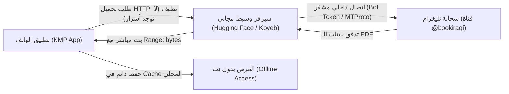

# وثيقة هندسة الاستضافة السحابية المجانية وحماية البيانات (Telegram-Backed Free Cloud Architecture)

> **تاريخ التوثيق:** 2026-10-22  
> **المشروع:** مكتبة ملازم وكتب الثالث متوسط (`Th3GradeLibraryKMP`)  
> **الهدف:** تفريغ ملفات الـ PDF الكبيرة (~1.5 جيجابايت) من أصول التطبيق ليصبح حجم ملف الـ APK أقل من 20 ميغابايت، وتحويل قناة تليغرام إلى سحابة تخزين غير محدودة ومجانية 100% مدى الحياة بدون أي بطاقة بنكية (Credit Card).

---

## 📌 الفهرس
1. [المحددات الصارمة والمخاطر الأمنية](#1-المحددات-الصارمة-والمخاطر-الأمنية)
2. [الخيارات الهندسية الثلاثة ومقارنة الحماية](#2-الخيارات-الهندسية-الثلاثة-ومقارنة-الحماية)
3. [الخيار المعتمد (الخيار الثاني: السحابة الوسيطة المحمية)](#3-الخيار-المعتمد-الخيار-الثاني-السحابة-الوسيطة-المحمية)
4. [معلومات الربط والأصول المحفوظة في القناة](#4-معلومات-الربط-والأصول-المحفوظة-في-القناة)
5. [دليل التنفيذ خطوة بخطوة للوكيل القادم](#5-دليل-التنفيذ-خطوة-بخطوة-للوكيل-القادم)

---

## 1. المحددات الصارمة والمخاطر الأمنية

> [!CAUTION]
> **تنبيه أمني فائق الأهمية (Security Warning):**
> يُمنع منعاً باتاً دمج مفاتيح حساب تليغرام الشخصي (`API_ID`, `API_HASH`, أو ملف الجلسة `.session`) أو توكن البوت الأساسي داخل شفرة تطبيق الأندرويد/KMP المترجمة؛ لأن عملية الهندسة العكسية (Reverse Engineering) وفك الـ APK سهلة للغاية ويمكن للمخترقين سحب الجلسة والتحكم في الحساب والقنوات.

> [!IMPORTANT]
> **قواعد المشروع الثابتة:**
> 1. **مجاني 100% مدى الحياة:** لا يجوز استخدام أي حل يتطلب إدخال بطاقة بنكية أو فيزا (مثل Cloudflare R2 الذي يطلب فيزا لتفعيله، أو خدمات AWS S3 المدفوعة).
> 2. **حظر تام لتعديل البوت القديم:** البوت `@Bookiraqbot` هو بوت رسمي يعمل عبر MenuBuilderBot يخدم الطلاب مباشرة، **ممنوع لمسه أو تخريب إعداداته نهائياً**.
> 3. **البوت المخصص للعمليات البرمجية:** تم تخصيص البوت الفارغ الجديد:
>    - **المعرف:** `@Boooootiraqibot`
>    - **التوكن:** `8862454952:AAGepkN8WMIZVSRWFLAHC24NTSdMZ4SSuFI`
>    - تم رفع هذا البوت كـ **مشرف (Admin)** بصلاحيات تنزيل ونشر الملفات داخل القناة الرسمية `@bookiraqi`.

---

## 2. الخيارات الهندسية الثلاثة ومقارنة الحماية

```
+---------------------------------------------------------------------------------------------------------+
|                                        مقارنة الخيارات الهندسية الثلاثة                                        |
+---------------------------------------------------------------------------------------------------------+
| المعيار / الخيار             | الخيار 1: MTProto مباشر بالتطبيق | الخيار 2: سحابة وسيطة مجانية | الخيار 3: روابط Telegram Direct |
+------------------------------+----------------------------------+------------------------------+---------------------------------+
| مستوى الحماية والأمان        | ⚠️ خطر وضعيف (المفاتيح تنكشف)  | 🛡️ أمان كامل 100% (المفاتيح بالسيرفر)| 🛡️ آمن (لا مفاتيح)             |
| السلاسة والتجربة للطالب     | ممتازة (تحميل وتخزين بالخلفية)   | ممتازة (تحميل كأي رابط ويب سريع) | متوسطة (تفتح تطبيق تليغرام الخارجي) |
| التكلفة المالية              | صفر دولار (مجاني)                | صفر دولار (مجاني بدون فيزا)  | صفر دولار (مجاني)               |
| دعم الملفات الكبيرة (> 20MB) | مدعوم حتى 2GB                   | مدعوم عبر السيرفر الوسيط    | مدعوم بالكامل داخل تليغرام      |
| متطلبات البطاقة البنكية      | لا توجد                         | لا توجد (HuggingFace / Koyeb)| لا توجد                         |
+------------------------------+----------------------------------+------------------------------+---------------------------------+
```

### تفصيل الخيارات:

### • الخيار الأول: دمج عميل تليغرام (MTProto Lite) داخل تطبيق KMP مباشرة
- **طريقة العمل:** يتم تضمين كود اتصال ببروتوكول MTProto داخل التطبيق، ويتصل مباشرة بسحابة تليغرام عبر الـ API.
- **المزايا:** سرعة فائقة في تنزيل أجزاء الملف (Chunked Multi-part) بدون أي خادم في المنتصف.
- **العيوب والمخاطر:** 
  - **مخاطرة أمنية:** مفاتيح `API_ID` و `API_HASH` تكون معرضة للاستخراج من الـ APK عبر أدوات الـ Decompilation مثل JADX.
  - تعقيد حجم المكتبة على الـ Kotlin Multiplatform وتوافقية الـ C-Libraries لـ TDLib على المعالجات المختلفة (arm64, x86).

### • الخيار الثاني (الخيار الموصى به والمعتمد): السحابة الوسيطة المجانية المحمية (Zero-Cost Stream Proxy)
- **طريقة العمل:** 
  - يتم نشر سيرفر خفيف جداً ومجاني للأبد (Python FastAPI / Streamer) على منصة مجانية بالكامل **لا تطلب بطاقة بنكية** مثل **Hugging Face Spaces** أو **Koyeb Free Tier**.
  - السيرفر الوسيط يحتفظ بالتوكن والمفاتيح كـ Environment Variables آمنة ومشفرة.
  - السيرفر يقوم بالاتصال بالقناة `@bookiraqi` أو البوت `@Boooootiraqibot` وبث الملف بتدفق (Chunked Streaming مع دعم `Range: bytes`).
  - تطبيق الهاتف يطلب فقط رابط ويب عادي ومباشر مثل:
    `https://username-th3grade-books.hf.space/file/241/العربي_ج2.pdf`
- **مستوى الحماية:** **100%**، التطبيق نظيف تماماً ولا يحتوي على أي بيانات اعتماد لحساب تليغرام أو مفاتيح سرية.
- **سلاسة التنزيل:** يدعم استئناف التنزيل، شريط التقدم داخل التطبيق، وحفظ الكتاب في ذاكرة التخزين المؤقت (`cacheDir`) ليُفتح أوفلاين في المرات القادمة.

### • الخيار الثالث: الاعتماد على روابط القناة العامة المباشرة (Deep Linking / Fallback)
- **طريقة العمل:** عند ضغط الطالب على زر تحميل الكتاب، يفتح التطبيق الرابط التلقائي لتليغرام:
  `tg://resolve?domain=bookiraqi&post=241` أو `https://t.me/bookiraqi/241`
- **المزايا:** مجاني 100%، لا يحتاج أي خادم أو وسيط، صفر كود إضافي.
- **العيوب:** يخرج الطالب خارج التطبيق مؤقتاً لفتح تليغرام، ولا يوفر تجربة قراءة مدمجة وسلسة داخل التطبيق نفسه إلا إذا قام الطالب بتنزيله يدوياً.

---

## 3. الخيار المعتمد (الخيار الثاني: السحابة الوسيطة المحمية)

### كيف نحقق الحماية القصوى والتحميل المجاني:


1. **الجهة الأمامية (KMP App):**
   - يقرأ مسار التنزيل من ملف الكتالوج الموحد [`third_middle_channel_catalog.json`](file:///D:/نسخ%20تطبيقات/Th3GradeLibraryKMP/third_middle_channel_catalog.json).
   - يفحص هل الملف موجود مسبقاً في مجلد الذاكرة المؤقتة:
     ```kotlin
     val localFile = File(context.cacheDir, "books/${item.fileName}")
     if (localFile.exists()) {
         openPdf(localFile)
     } else {
         startDownloadWithProgress(streamUrl, localFile)
     }
     ```
2. **الجهة الخلفية (Backend Proxy):**
   - سكريبت بايثون خفيف (FastAPI) بحجم صفحة كود واحدة.
   - يستمع للمسار: `GET /stream/{msg_id}`
   - يجلب الرسالة من قناة `@bookiraqi` عبر البوت `@Boooootiraqibot`، ويبث المحتوى للعميل مباشرة دون تخزين مؤقت يستهلك مساحة السيرفر.

---

## 4. معلومات الربط والأصول المحفوظة في القناة

> [!NOTE]
> الكتالوج الكامل المرفوع والمفهرس موجود داخل المشروع في الملف:  
> [`third_middle_channel_catalog.json`](file:///D:/نسخ%20تطبيقات/Th3GradeLibraryKMP/third_middle_channel_catalog.json)

- **القناة الرسمية المعتمدة:** `@bookiraqi` (معرف المعرف الرقمي: `-1001329888197`).
- **البوت الوسيط الحصري:** `@Boooootiraqibot`
- **توكن البوت:** `8862454952:AAGepkN8WMIZVSRWFLAHC24NTSdMZ4SSuFI`
- **عدد الكتب المرفوعة:** 10 كتب وزارية (معرفات الرسائل `msg_id` من `146` إلى `241`).
- **عدد الملازم المرفوعة:** 32 ملزمة دراسية (معرفات الرسائل `msg_id` من `284` إلى `317`).

---

## 5. دليل التنفيذ خطوة بخطوة للوكيل القادم (Next Agent Instructions)

عند تسليم هذه المهمة لأي وكيل ذكاء اصطناعي في محادثة لاحقة، يجب عليه اتباع الخطوات التالية بالترتيب:

### الخطوة 1: نشر السيرفر الوسيط (FastAPI Proxy)
- إنشاء مجلد صغير `server_proxy` يحتوي على:
  - `app.py`: كود FastAPI + Telethon (أو `httpx` لـ Bot API) لبث الملفات عبر دالة `StreamingResponse`.
  - `requirements.txt`: `fastapi`, `uvicorn`, `telethon`.
- نشر المشروع على منصة **Hugging Face Spaces (Docker/Python)** أو **Koyeb** مجاناً، وإضافة المتغيرات:
  - `BOT_TOKEN = "8862454952:AAGepkN8WMIZVSRWFLAHC24NTSdMZ4SSuFI"`
  - `CHANNEL_ID = "-1001329888197"`
- الحصول على الرابط المجاني العام (مثال: `https://karrar-th3books.hf.space`).

### الخطوة 2: تحديث شاشة العرض في التطبيق (`PdfViewerScreen.kt`)
- فتح الملف:
  [`D:\نسخ تطبيقات\Th3GradeLibraryKMP\shared\src\commonMain\kotlin\com\karrar\library\presentation\screens\PdfViewerScreen.kt`](file:///D:/نسخ%20تطبيقات/Th3GradeLibraryKMP)
- إضافة حالة تنزيل تفاعلية (`DownloadState: Idle, Downloading(progress: Float), Ready(file), Error`).
- عند فتح الكتاب:
  - فحص وجود الملف محلياً في الـ Cache.
  - إذا لم يكن موجوداً، عرض شريط دائري/خطي يوضح نسبة التنزيل المئوية، ثم فتح الملف فور اكتمال التنزيل.

### الخطوة 3: تفريغ الملفات الكبيرة من الـ Assets
- مسح ملفات الـ PDF الكبيرة من المجلدات:
  - `shared/src/commonMain/composeResources/files/books`
  - `shared/src/commonMain/composeResources/files/notes`
- التأكد من بناء المشروع بنجاح:
  ```powershell
  ./gradlew assembleDebug
  ```
- التأكد من انخفاض حجم ملف الـ APK النهائي من ~1.5 جيجابايت إلى **أقل من 20 ميغابايت**.
