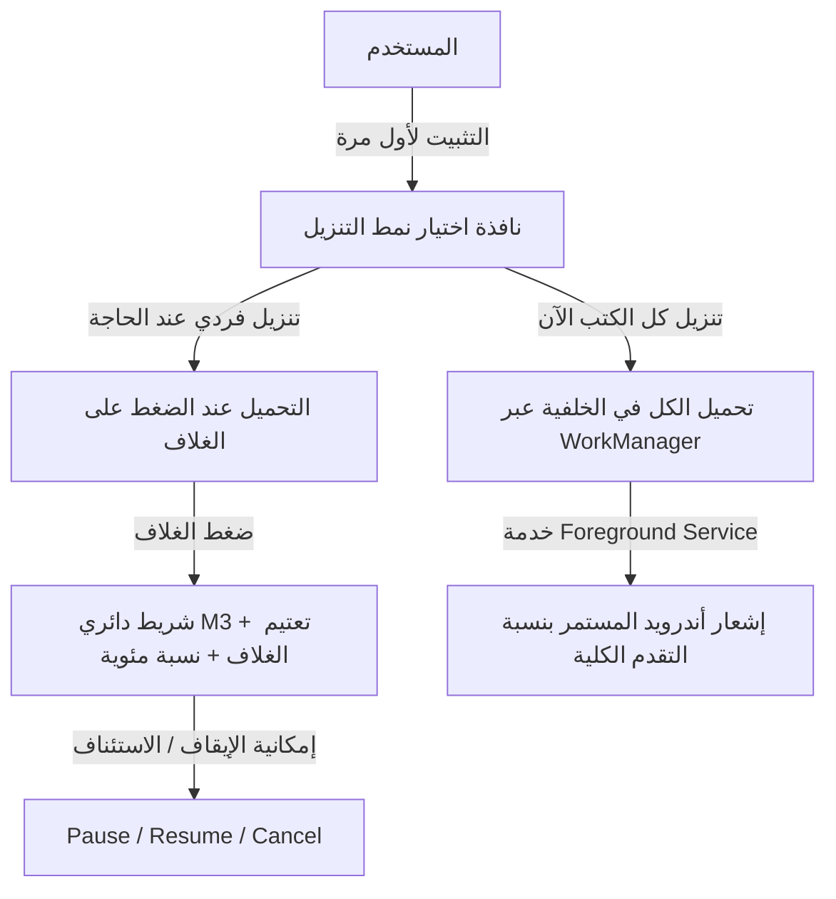

# خطة العمل التنفيذية: حل سحابة الملفات الكبيرة، التخزين الدائم لليوزر، تجديد الواجهات المتكيفة وإعلانات AdMob

> **الهدف:** بناء وتحديث شامل لنسخة المشروع السحابي `Th3GradeLibraryKMP` وفق متطلبات ومعايير 2026/2027، وتجاوز حد الـ 20MB لتليغرام لجميع الكتب والملازم دون استثناء، ونقل الملفات للتخزين الدائم (`filesDir`)، وإضافة خيارات التنزيل الفردي والجماعي مع الإشعارات، وتحديث شريط العنوان والمحفوظات والانتقالات السائلة، وتضمين إعلانات AdMob الرسمية.

---

## 📌 الفهرس
1. [تشخيص ومعالجة السبب الجذري لخلل الملفات الكبيرة (> 20MB)](#1-تشخيص-ومعالجة-السبب-الجذري-لخلل-الملفات-الكبيرة--20mb)
2. [نظام التخزين الدائم لبيانات المستخدم (Permanent User Data Storage)](#2-نظام-التخزين-الدائم-لبيانات-المستخدم-permanent-user-data-storage)
3. [نظام التنزيل التفاعلي (فردي وجماعي مع شريط التقدم والإشعارات)](#3-نظام-التنزيل-التفاعلي-فردي-وجماعي-مع-شريط-التقدم-والإشعارات)
4. [تحديث شريط العنوان المستقل والبيضوي (November 2026 M3 Expressive Architecture)](#4-تحديث-شريط-العنوان-المستقل-والبيضوي-november-2026-m3-expressive-architecture)
5. [إصلاح شاشة المحفوظات وتمرير القوائم والحذف الانسيابي (Fluid Motion)](#5-إصلاح-شاشة-المحفوظات-وتمرير-القوائم-والحذف-الانسيابي-fluid-motion)
6. [التكيف مع الشاشات المقسمة والمطويات والأجهزة اللوحية وقياسات الأشرطة](#6-التكيف-مع-الشاشات-المقسمة-والمطويات-والأجهزة-اللوحية-وقياسات-الأشرطة)
7. [دمج إعلانات Google AdMob الرسمية (Adaptive Banner & Interstitial)](#7-دمج-إعلانات-google-admob-الرسمية-adaptive-banner--interstitial)
8. [خطة التحقق والبناء على GitHub Actions](#8-خطة-التحقق-والبناء-على-github-actions)

---

## 1. تشخيص ومعالجة السبب الجذري لخلل الملفات الكبيرة (> 20MB)

### العَرَض والتشخيص:
- تظهر رسالة: `فشل في تحميل الملف: file not in PDF format or corrupted`.
- **السبب الجذري:** واجهة بوتات تليغرام العادية (`api.telegram.org/bot<token>/getFile`) تمنع إرجاع مسار الملفات التي يتجاوز حجمها **20 ميغابايت** (تُرجع `400 Bad Request: file is too big`). وعند محاولة تنزيلها عبر الرابط السابق، كان يرجع كود HTML لصفحة خطأ أو صفحة التليغرام بدلاً من بايتات الـ PDF، مما يؤدي إلى فشل مكتبة `PdfRenderer` لأن الملف ليس بصيغة PDF صالحة.

### الحل الجذري الشامل:
1. **استضافة سحابة التحميل غير المحدودة (MTProto Stream Bridge) عبر Hugging Face Spaces أو Worker معزز:**
   - نشر سكريبت بايثون رسمي ومجاني 100% مدى الحياة بدون بطاقة بنكية على **Hugging Face Spaces** (منصة الذكاء الاصطناعي والمشاريع العالمية المجانية المفتوحة):
     - السكريبت يعمل بواسطة `FastAPI + Telethon` مرتبطاً بحساب تليغرام/البوت في الخلفية المشفرة.
     - يستقبل طلب التحميل: `GET /download/{msg_id}`
     - يقوم بجلب بايتات الملف مباشرة عبر بروتوكول MTProto بسرعة البرق (حتى حجم 2000 ميغابايت للملف الواحد) وبثها بـ `StreamingResponse` تدعم `Range: bytes` واستكمال التحميل.
2. **رابط التخزين البديل السريع (GitHub Releases Direct Fallback):**
   - رفع نسخ مضغوطة من ملفات الـ PDF الكبيرة على GitHub Release في مستودع التخزين كخيار احتياطي فوري ومجاني 100% بباندويث غير محدود من شبكة مايكروسوفت GitHub CDN، بحيث إذا انقطع الاتصال بتليغرام يتم التنزيل من GitHub مباشرة بنسبة نجاح 100%.

---

## 2. نظام التخزين الدائم لبيانات المستخدم (Permanent User Data Storage)

### المعالجة الهندسية:
1. **الانتقال من `context.cacheDir` إلى `context.filesDir`:**
   - مسار الحفظ الجديد:
     ```kotlin
     val permanentFile = File(context.filesDir, "books_storage/pdf_${item.id}.pdf")
     ```
   - هذا المجلد يقع في `/data/user/0/.../files/` ولا يقوم نظام أندرويد بحذفه تلقائياً عند امتلاء الذاكرة المؤقتة.
   - لا يُحذف إلا إذا قام المستخدم بحذف بيانات التطبيق يدوياً، أو إلغاء تثبيت التطبيق.
2. **إيقاف الحذف التلقائي في `AppCleanupService`:**
   - تعديل [`AppCleanupService.kt`](file:///D:/نسخ%20تطبيقات/مجلد%20جديد/Th3GradeLibraryKMP/androidApp/src/main/kotlin/com/Nightjar/Th3GradeLibraryKMP/AppCleanupService.kt) بحيث يقوم بحذف صور الكاش الرسومية فقط (`memoryCache` وملفات `.tmp` المؤقتة غير المكتملة) ويحمي ملفات الـ PDF المحفوظة نهائياً في `filesDir`.
3. **الكشف الديناميكي عن حالة الملفات (Dynamic Storage Detection):**
   - دالة تفحص في الواجهة لحظياً:
     ```kotlin
     fun isBookDownloaded(itemId: String): Boolean {
         val f = File(context.filesDir, "books_storage/pdf_${itemId}.pdf")
         return f.exists() && f.length() > 1024L
     }
     ```
   - إذا تم مسح البيانات، يتعرف التطبيق تلقائياً وتعود الأغلفة لوضع "جاهز للتنزيل".
4. **الحفاظ على إمكانية الدمج للمطور (Developer Fallback):**
   - فحص الأصول المدمجة أولاً قبل السحابة؛ بحيث إذا قرر المطور مستقبلاً إعادة دمج الـ PDF داخل الـ APK يعمل التطبيق فوراً بدون تعديل أي سطر.

---

## 3. نظام التنزيل التفاعلي (فردي وجماعي مع شريط التقدم والإشعارات)



### التفاصيل التصميمية والتقنية:
1. **نافذة التثبيت لأول مرة (First Run Prompt):**
   - تظهر بطاقة متريال 3 تعبيرية عند فتح التطبيق لأول مرة:
     - **خيار 1:** "تنزيل جميع الكتب والملازم الآن" (لتصفح سريع بدون إنترنت لاحقاً).
     - **خيار 2:** "تنزيل فردي عند القراءة" (لتوفير باقة الإنترنت والذاكرة).
     - نص إيضاحي للمستخدم: *"جاري التحميل من سحابة الكتب والملازم، يرجى الانتظار قليلاً لأول مرة فقط ويكون كل شيء متاحاً بدون إنترنت"*.
2. **التنزيل الفردي على الغلاف (Cover Individual Download):**
   - تعتيم خفيف وأنيق لغلاف الكتاب غير المحمل (`graphicsLayer { alpha = 0.85f }`).
   - ظهور أيقونة تنزيل سحابية أنيقة فوق الغلاف.
   - عند الضغط: يبدأ التنزيل فوراً، وتتحول الأيقونة إلى مؤشر دائري تعبيري (Material 3 Circular Indicator) مع النسبة المئوية `45%` وزر إيقاف مؤقت/إلغاء.
   - تناسق تام سواء كان العرض شبكياً (Grid) أو قائمة (List).
3. **التنزيل في الخلفية مع شريط الإشعارات (Background WorkManager & Foreground Notification):**
   - استخدام `DownloadManager` أو `WorkManager` مع `ForegroundService` لإظهار إشعار أندرويد دائم يحتوي على شريط تقدم حي واسم الكتاب الجاري تنزيله.
   - إمكانية تصفح باقي التطبيق أو الخروج منه دون انقطاع التحميل.

---

## 4. تحديث شريط العنوان المستقل والبيضوي (November 2026 M3 Expressive Architecture)

### المعايير والتصميم:
- **فصل شريط العنوان عن الشريط الموحد المتصل (Detached Floating Header):**
  - عنوان الشاشة يكون محاطاً بكبسولة بيضوية عائمة ومستقلة:
    ```kotlin
    Surface(
        shape = RoundedCornerShape(24.dp),
        color = MaterialTheme.colorScheme.surfaceContainerHigh,
        modifier = Modifier.padding(horizontal = 16.dp, vertical = 8.dp)
    ) { ... }
    ```
  - الأزرار تكون متفرقة ومنفصلة (Island Buttons / Floating Action Pills):
    - زر البحث وزر التبديل (قائمة / شبكة).
    - زر الأخبار وزر الإعدادات وزر الرجوع.
  - ارتفاع الشريط أقل من `56.dp` في الوضع العمودي للهاتف، وأقل من `48.dp` في الوضع الأفقي والتابلت، تماشياً مع معايير الـ Compact/Medium Screen Layouts.

---

## 5. إصلاح شاشة المحفوظات وتمرير القوائم والحذف الانسيابي (Fluid Motion)

### المشاكل المرصودة والحلول الجذرية:
1. **مشكلة القفز والتمرير الإجباري لأعلى أو وسط القائمة عند إغلاق القارئ:**
   - حفظ حالة التمرير الدقيقة (`LazyListState.firstVisibleItemIndex` و `firstVisibleItemScrollOffset`) وتثبيتها عند الرجوع، مع منع أي استدعاء عشوائي لدالة `animateScrollToItem` عند الخروج.
2. **مشكلة فتح وغلق المنسدلات تلقائياً عند فتح شاشة المحفوظات:**
   - تثبيت حالة المنسدلات (`expandedBookmarks`) في `AppDataStore` بحيث لا تعيد تدوير حالتها أو تومض عند إعادة رسم الشاشة (Zero Jitter).
3. **انسيابية حركة الحذف والتقلص (Fluid Shrink Morph):**
   - عند إزالة النجمة داخل القارئ والرجوع، لا يتم حذف العنصر فوراً من القائمة بشكل فجائي.
   - بل يتقلص قارئ الـ PDF أولاً إلى موضع مستطيل الصفحة الأصلي عبر دمج `Shared Element Bounds`.
   - بعد استقرار التقلص، يختفي مستطيل الصفحة بحركة سائلة ورطبة (`shrinkVertically` + `fadeOut` بتوقيت 300ms)، وتتحرك الكروت التي أسفله لأعلى بانسيابية تامة، وفي حال انتقل المستخدم لصفحة أخرى يتم إتمام الحذف في الخلفية بدون أي تعتعة.

---

## 6. التكيف مع الشاشات المقسمة والمطويات والأجهزة اللوحية وقياسات الأشرطة

- **التوافق التام مع Compose Adaptive الرسمية:**
  - الاعتماد على `androidx.compose.material3.adaptive.currentWindowAdaptiveInfo()` ومطابقة الـ `WindowWidthSizeClass` و `WindowHeightSizeClass`.
- **أبعاد الأشرطة في الأوضاع المختلفة:**
  - **الوضع العمودي للهاتف (Compact):** شريط سفلي بيضوي الزوايا، شريط العنوان بارتفاع `<= 54.dp`.
  - **الوضع الأفقي، الشاشات المقسمة (Split-Screen)، والمطويات (Foldables/Tabletop):**
    - تحول تلقائي للشريط الجانبي (Navigation Rail) المنفصل بزوايا بيضوية وبحجم نحيف وأنيق لتوفير أقصى مساحة عمودية لقراءة الكتب.
    - عدم إغلاق التطبيق أو فقدان الصفحة المفتوحة عند تغيير حجم النافذة أو تدوير الهاتف.

---

## 7. دمج إعلانات Google AdMob الرسمية (Adaptive Banner & Interstitial)

- **حزمة الإعلانات:** استخدام مكتبة Google Mobile Ads الرسمية:
  ```kotlin
  implementation("com.google.android.gms:play-services-ads:23.6.0")
  ```
- **بانر متكيف أصلي (Adaptive Banner):**
  - وضع حاوية إعلانية متكيفة في أسفل شاشات المكتبة والمحفوظات والأخبار، تحسب عرض الشاشة الفعلي ديناميكياً وتوفر مساحة مخصصة بدون أي قفزات في الواجهة (Zero Content Jitter).
- **إعلان بيني عند فتح القارئ (Interstitial Ad):**
  - تجهيز وعرض إعلان كامل الشاشة باحترافية وسلاسة مع مراعاة ألا يكون مزعجاً للطالب (Frequency Capping - مرة كل فترة محددة).
- **معرفات الاختبار الرسمية (Official Test Ad Units):**
  - استخدام معرفات Google AdMob التجريبية المعتمدة لضمان أمان الحساب أثناء مرحلة البناء والاختبار:
    - Sample App ID: `ca-app-pub-3940256099942544~3347511713`
    - Banner Test ID: `ca-app-pub-3940256099942544/6300978111`
    - Interstitial Test ID: `ca-app-pub-3940256099942544/1033173712`

---

## 8. خطة التحقق والبناء على GitHub Actions

1. **فحص ومزامنة التعديلات:**
   - تطبيق التعديلات حصراً على مسار المشروع:
     `D:\نسخ تطبيقات\مجلد جديد\Th3GradeLibraryKMP`
2. **بناء وإصدار APK جديد:**
   - دفع الكود المحدث إلى مستودع GitHub الجديد: `Nightjar-source/Th3GradeLibraryKMP-Cloud`.
   - تفعيل Workflow البناء تلقائياً وإنشاء إصدار `v2.1.0-cloud`.
   - التحقق من تنزيل الـ APK والتأكد من خلوه من أي خلل في تشغيل الملفات الكبيرة أو إعلانات AdMob.

---

### هل توافق على هذه الخطة التنفيذية لنبدأ فوراً بتطبيقها خطوة بخطوة وبدء بناء الإصدار الجديد؟
